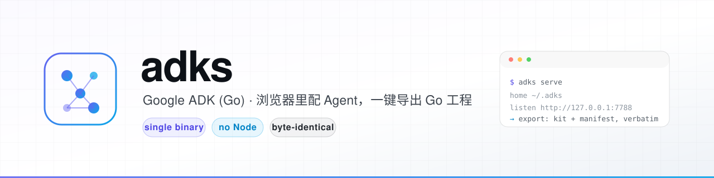
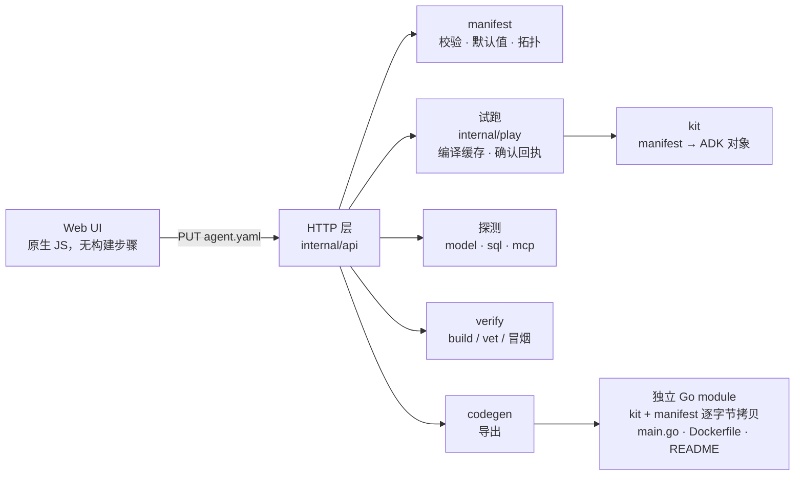

<div align="center">

<picture>
  <source media="(prefers-color-scheme: dark)" srcset="docs/assets/banner-dark.svg">
  <source media="(prefers-color-scheme: light)" srcset="docs/assets/banner-light.svg">
  
</picture>

**在浏览器里配好一个 Agent，直接试跑，然后导出一份可编译、可部署的独立 Go 工程。**

[](https://github.com/usherf233/adks/actions/workflows/ci.yml)
[](go.mod)
[](https://github.com/usherf233/adks/releases)
[](LICENSE)
[](https://pkg.go.dev/github.com/usherf233/adks)

</div>

---

## 这是什么

`adks` 是一个**单二进制**的 [Google ADK for Go](https://google.golang.org/adk) 脚手架。启动后是一个本地 Web 界面，你在里面选模型、写指令、挂工具、连数据库，然后：

- **试跑** —— 流式对话，工具调用要你点确认才执行；
- **验证** —— `build` / `vet` / 冷启动三项确定性检查，全绿才放行；
- **导出** —— 拿到一个完整的 Go module，`go run .` 就能跑，不依赖本工具。

全程不需要写 Go 代码，也不需要 Node 运行时。

## 两条不可妥协的原则

| 原则 | 为什么 |
|---|---|
| **导出 = 复制，不重写** | `kit/` 与 `manifest/` 从 builder 的 embed FS 里逐字节拷出，不做模板渲染。两份实现永远无法保证同步，所以干脆不要第二份。 |
| **校验只认事实** | build / vet / 二进制能否启动是 pass-fail 事实，不请模型给自己的输出打分。 |

这两条决定了整个设计：builder 里跑的和你导出的，是同一份源码、同一个 manifest —— 行为不会漂移，字节也一样。

## 架构



依赖方向单向：`cmd → internal/* → kit → manifest`，无反向引用。`manifest` 除 `yaml.v3` 外零依赖，正是为了能被原样拷走。

`internal/api` 只做 HTTP：解析请求、收敛状态码、编码 SSE。所有"活下去的状态"——编译缓存（持有 MCP 子进程与 session 库）、待确认回执、确认后重入的循环——都在 `internal/play`，并由它独占关停契约。

## 快速开始

**方式一：下载预编译二进制** —— 见 [Releases](https://github.com/usherf233/adks/releases)，linux / darwin / windows 五个平台，解压即用。

**方式二：从源码构建**

```bash
git clone git@github.com:usherf233/adks.git
cd adks
go build -o adks ./cmd/adks
./adks serve                      # → http://127.0.0.1:7788
```

**方式三：`go install`**

```bash
go install github.com/usherf233/adks/cmd/adks@latest
```

| 参数 | 说明 |
|---|---|
| `-host` | 监听地址，默认 `127.0.0.1`；绑非回环地址**必须**设 `ADKS_TOKEN` |
| `-port` | 端口，默认 `7788` |
| `-home` | 项目存放目录，默认 `~/.adks`（也可用 `ADKS_HOME`） |

> 模型密钥不进 manifest，只写 `${ENV}` 引用，运行时由环境变量提供。

## 一个项目长什么样

```yaml
apiVersion: adks/v1
kind: AgentProject
metadata:
  slug: support-bot
  name: Support Bot
spec:
  agent:
    name: support_bot_agent
    description: A general purpose assistant.
    instruction: |
      You are a helpful assistant. Answer in the language the user writes in.
    model:
      provider: gemini          # gemini | openai | anthropic
      name: gemini-flash-latest
      apiKeyEnv: GOOGLE_API_KEY
  tools:
    http:
      - name: lookup_order
        method: GET
        url: https://api.example.com/orders/{id}
        allowedHosts: [api.example.com]
  runtime:
    server: { mode: full, host: 127.0.0.1, port: 8080 }
    session: { backend: sqlite, dsn: ./data/sessions.db, autoMigrate: true }
```

导出的工程自带 `kit/` 与 `manifest/`，启动方式由 `agent.yaml` 决定：

```bash
go mod tidy
go run .                            # 按 agent.yaml 里的 mode 起
go run . web -port 8080 webui api   # 完整 Web：聊天 UI + REST API
go run . web -port 8080 api         # 纯 REST API
go run . console                    # 终端聊天，不开浏览器
```

## 能配什么

| 维度 | 支持 |
|---|---|
| **形态** | 单 LLM Agent（`mode: llm`，默认）或工作流图（`mode: graph`，节点 `agent` / `tool` / `route` / `join` / `subgraph`） |
| **模型** | Gemini / OpenAI / Anthropic；OpenAI 兼容端点可用 `baseURL`（留空回退 `OPENAI_BASE_URL`） |
| **工具** | 内置工具、HTTP 工具（域名白名单 + 响应体积上限）、MCP server（仅本地命令或回环地址）、tool search |
| **存储** | SQLite / MySQL / Postgres；会话、记忆、artifact 分别可选后端 |
| **安全** | 破坏性工具需人工确认、单次运行限额（LLM 调用数 / 墙钟 / 工具并发 / 指令体积） |
| **插件** | ADK 插件引用、回调、审计日志 |
| **运行时** | 监听 host/port（host 可用 `ADKS_HOST` 覆盖）、`pathPrefix` 改写 REST 前缀、`a2a` 端点、健康检查、打包 Dockerfile |

## HTTP API

| 方法 | 路径 | 用途 |
|---|---|---|
| GET | `/api/health` | 存活探测 |
| GET/POST | `/api/projects` | 列表 / 新建 |
| GET/PUT/DELETE | `/api/projects/{slug}` | 读取 / 保存 / 删除 |
| GET | `/api/projects/{slug}/versions` | 版本列表 |
| POST | `/api/projects/{slug}/rollback` | 回滚到某个版本 |
| GET | `/api/projects/{slug}/graph` | 只读拓扑图 |
| POST | `/api/projects/{slug}/probe/{model,sql,mcp}` | 连通性探测 |
| POST | `/api/projects/{slug}/play` | 流式试跑（SSE） |
| POST | `/api/projects/{slug}/play/confirm` | 工具调用确认 |
| GET | `/api/projects/{slug}/files` | 导出前文件预览 |
| POST | `/api/projects/{slug}/verify` | build / vet / 冒烟 |
| POST | `/api/projects/{slug}/export` | 导出 zip |

状态码统一：项目或快照不存在 → `404`；manifest 解析失败 → `getProject` 返回 200 + `loadError`（编辑器必须能打开修），其余端点 `400`。

## 开发

```bash
make build        # 构建
make check        # build + vet + test -race（完整）
make check-fast   # 同上，跳过编译/启动生成物的慢测试，约 7 秒
make run          # 构建并启动
```

> 慢测试占整套墙钟的 90% 以上，但对"改对了没有"几乎没有信息量——本地迭代用 `check-fast`，提 PR 前跑一次完整 `check`。

Windows 上没装 make 也没关系，等价的手工命令：

```bash
go build ./...
go vet ./...
go test -race -count=1 ./...
```

> ⚠️ 改了 `kit/`、`manifest/` 或 `web/` 之后**必须重新编译 `adks`**。embed 在编译期快照，旧二进制会导出缺文件或旧代码的工程。

## 目录结构

```
cmd/adks/          入口：serve / version
internal/api/      HTTP 层：CRUD、探测、导出、状态码收敛（试跑转发给 play）
internal/play/     试跑：编译缓存（含空闲淘汰）、确认回执、确认后重入
internal/store/    文件系统存储（一个项目 = 一个目录），无数据库
internal/codegen/  渲染导出工程：整包复制 kit/manifest + 生成 main.go / Dockerfile / README
internal/verify/   build、vet、冒烟启动三项确定性检查
kit/               manifest → ADK 对象（embed 进 builder，也拷进生成物）
manifest/          schema 定义、校验规则、默认值、拓扑校验
web/               UI 静态资源（原生 JS，无构建步骤）
designs/           架构设计台账
```

## 已知边界

- 不做多 Agent 拖拽编排画布；graph 可视化只读。
- 不做运行时多租户鉴权，只靠单个 bearer token（`ADKS_TOKEN`）。
- **MCP stdio 会执行 manifest 里写的任意命令**（`command` / `args` 不做白名单），HTTP 工具则受 `allowedHosts` 限制。所以"能让别人改 manifest"等价于"能让别人在这台机器上执行命令"——绑非回环地址之前先想清楚这一点。
- 不支持在 UI 里写自定义 Go 工具函数。
- 导出工程的 `runtime.server.port` 是生成期常量，改了需重新导出；`host` 同样编译进二进制，但可用 `ADKS_HOST` 在运行期覆盖（容器部署必须设 `0.0.0.0`，否则端口映射打不到）。

## 文档

- [`designs/adks-harness-design-v1.md`](designs/adks-harness-design-v1.md) — 架构设计台账：需求规格、关键决策、未知区、评审结论。
- [`CONTRIBUTING.md`](CONTRIBUTING.md) — 提 PR 之前值得看一眼的几条。

<div align="center">

**[MIT License](LICENSE)** · 用 Go 写成，没有前端构建链。

</div>
